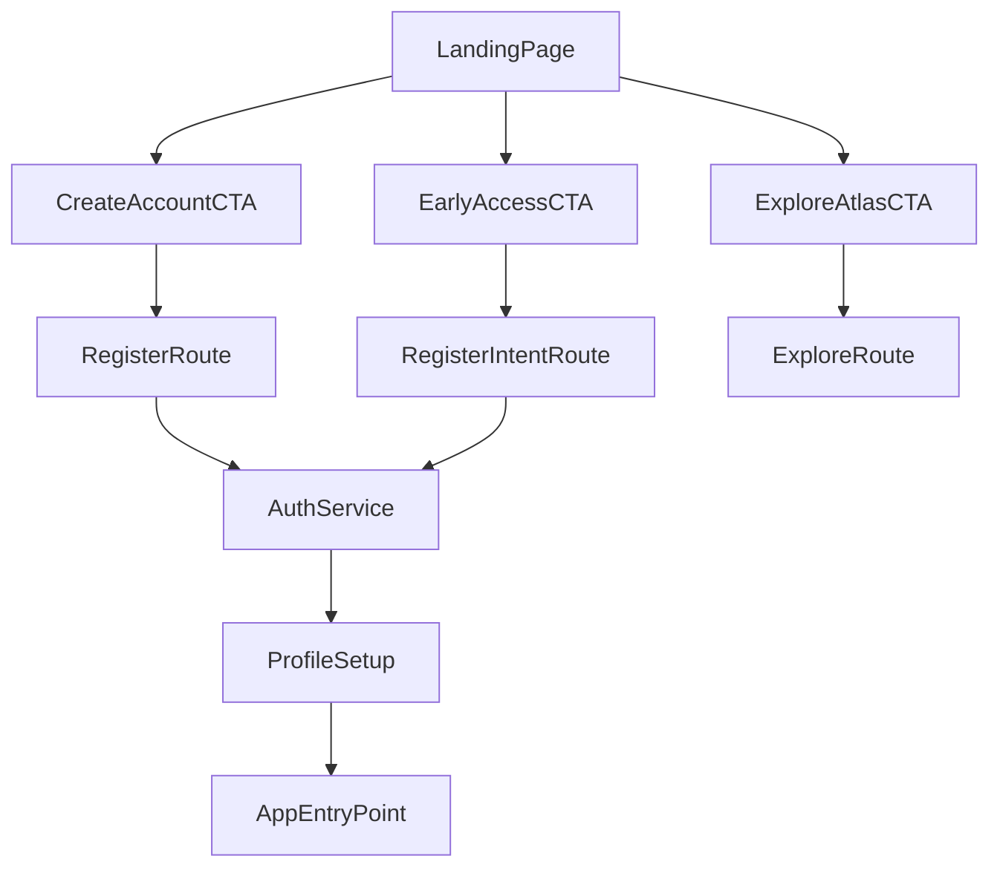

# Landing Page Information Architecture and CTA Handoff

## Landing Page Mission

The landing page must answer three questions in under five seconds:

1. What is Atlas Universalis?
2. Who is it for?
3. What action should happen next?

## Audience Segments

- Founders/operations leaders evaluating Atlas as a platform.
- Technical users exploring capabilities and ecosystem fit.
- Prospective members/users ready to create an account.

## Information Architecture

## 1) Hero (Above the Fold)

- Primary message: Atlas value proposition and strategic positioning.
- Supporting line: concise proof of utility and trust signal.
- Primary CTA: `Create Account`
- Secondary CTA: `Explore Atlas`
- Tertiary CTA (optional): `Join Early Access`

## 2) Core Value Pillars

- 3-4 cards summarizing product value pillars.
- Each card links to deeper capability or relevant future section.

## 3) Platform Overview

- Visual/simple narrative of how landing -> account -> profile -> app modules works.
- Clarifies that account/profile is the first persistent user step.

## 4) Feature Preview Strip

- Lightweight previews of near-term app capabilities.
- Highlights that auth/profile unlocks personalized experience.

## 5) Trust and Credibility

- Security posture, reliability statements, and operational maturity hints.
- Optional partner/client proof when available.

## 6) Final Conversion Band

- Repeated high-intent CTA with low-friction copy.
- Includes links to policy/terms and contact/support.

## CTA Routing and Handoff

- `Create Account` -> `/account/create`
- `Explore Atlas` -> `/app/explore` (public exploration page or preview mode)
- `Join Early Access` -> `/account/create?intent=early-access`
- If authenticated users hit onboarding CTA -> `/account/profile/setup`

## CTA Event Taxonomy

- `landing_cta_create_account_clicked`
- `landing_cta_explore_clicked`
- `landing_cta_early_access_clicked`
- `landing_section_viewed` (with section key)

Include UTM capture where present and forward to auth onboarding context.

## Handoff Flow

## Content and UX Notes

- Maintain premium, confident, mythic tone while keeping copy plain-language and actionable.
- Use scannable section headers and concise body copy.
- Keep CTA text explicit; avoid abstract action verbs.
